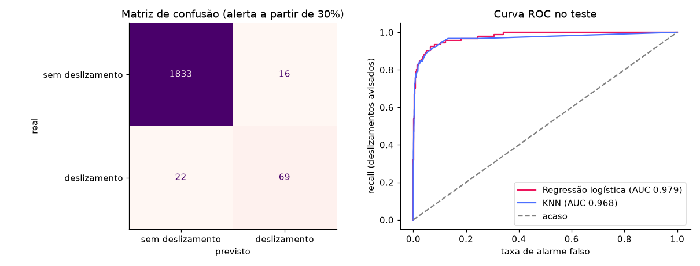

# Encosta Segura · modelo de risco de deslizamento (IA & ML)

## Ficha da CitizenTech

| Campo | Conteúdo |
|---|---|
| **Nome da CitizenTech** | Encosta Segura |
| **Cidade e bairro** | Vale da Serra – SP · bairro Morro Verde (cidade e bairro fictícios, criados pela equipe para a simulação) |
| **Cidadão beneficiado** | Moradores de encostas e de áreas alagáveis à beira de córregos; agentes da Defesa Civil. |
| **Problema, em uma frase** | Quem mora em área de risco não recebe aviso a tempo de deslizamentos e alagamentos, nem sabe para onde ir quando o perigo chega. |
| **Como funciona** | Estações IoT medem o terreno e o córrego, um modelo de IA calcula o risco e o app avisa cada morador com o que fazer e a rota segura até o ponto de apoio. |
| **O que cada parte faz** | Circuito ESP32: mede e calcula o risco · **IA/ML: modelo que prevê o risco** · API: recebe leituras e dispara alertas · App: alerta, ocorrências e relatos dos moradores · Desktop C#: painel da Defesa Civil · Windows Server: hospeda o sistema · Cyber: proteção dos dados · TOGAF: arquitetura. |
| **Indicador de impacto** | Minutos entre o alerta ALTO e a confirmação "Estou seguro" de cada família (meta: menos de 15 minutos). |
| **ODS conectados** | ODS 11, ODS 13, ODS 3, ODS 10, ODS 9. |

## Equipe

| Nome | RM |
|---|---|
| Maria Eduarda Ferrés | 560418 |
| Gabriela Queiroga Cocuzza da Silva | 560035 |
| Davi Corrêa Paião | 560438 |

## O que este componente faz

Recebe as quatro leituras da estação da encosta e devolve a **probabilidade de deslizamento** e o **nível de risco**:

| Probabilidade | Nível | O que o morador faz |
|---|---|---|
| menor que 30% | BAIXO | continua acompanhando |
| de 30% a 70% | ATENÇÃO | separa documentos e fica pronto para sair |
| 70% ou mais | ALTO | sai de casa e vai ao ponto de apoio |

Se o terreno inclinar **10° ou mais**, o nível vai para ALTO direto (regra de segurança do ESP32).

## Resultado

Teste com 1.940 leituras que o modelo nunca viu:

| Métrica | Valor |
|---|---|
| **Recall** da classe deslizamento, com alerta a partir de 30% | **75,8%** (69 de 91 deslizamentos avisados) |
| Precisão, com alerta a partir de 30% | 81,2% (16 alarmes falsos) |
| AUC-ROC | 0,979 (KNN: 0,968) |



## Arquivos

```
ia-ml/
  encosta_segura_ml.ipynb        notebook completo, já executado
  data/
    leituras_encosta_bruto.csv   8.025 leituras simuladas, com as falhas de sensor
    leituras_encosta_limpo.csv   7.760 leituras depois da limpeza
  models/
    modelo_risco.joblib          modelo treinado (pipeline do scikit-learn)
    coeficientes_esp32.json      os 5 números do modelo, limiares e métricas
  figuras/                       gráficos usados neste README
  requirements.txt
```

## Como rodar

**No Google Colab (mais fácil):** abra o `encosta_segura_ml.ipynb` no Colab (Arquivo → Fazer upload de notebook) e clique em **Ambiente de execução → Executar tudo**. O notebook gera o dataset sozinho e cria as pastas `data/`, `models/` e `figuras/`.

**No computador:**

```bash
pip install -r requirements.txt
jupyter notebook encosta_segura_ml.ipynb
```

Depois, **Kernel → Restart & Run All**. Tudo usa `seed = 42`, então os números saem iguais aos deste README.

## Origem dos dados

**Os dados são simulados pela própria equipe.** Não existe base pública com leituras de sensores de encosta (umidade do solo e inclinação) ligadas a deslizamentos que aconteceram ou não.

A simulação segue critérios reais da Defesa Civil:

- O Plano Preventivo de Defesa Civil (PPDC) de São Paulo usa principalmente a **chuva acumulada de 72 horas**, junto com a umidade do solo e as evidências de movimento do terreno ([Revista do Departamento de Geografia, USP](https://periodicos.usp.br/rdg/article/download/165390/166516/457600)).
- Na cidade de São Paulo, a **atenção** começa com **60 mm em 72 h**, e a chuva é fraca até 5 mm/h, moderada até 30 mm/h e forte acima disso ([Prefeitura de São Paulo](https://prefeitura.sp.gov.br/web/comunicacao/w/noticias/108584)).
- Na Região de Campinas, a atenção começa com **80 mm em 72 h** ([Atlas Público, Resolução CMIL 039/610/26](https://atlaspublico.com.br/estados/sp/noticias/casa-militar-de-sp-institui-plano-de-contingencia-contra-92507)).

Para o problema não ficar fácil demais, a simulação inclui coisas que a estação **não mede** (tipo de solo e formato de cada encosta), **ruído** nos sensores e **falhas** (leitura vazia, umidade de 150%, código de erro -1 no pluviômetro e leituras repetidas). A função `gerar_leituras` no notebook mostra todas as regras.

## Decisões

| Decisão | Por quê |
|---|---|
| **Quatro variáveis:** umidade do solo, chuva em 72 h, intensidade e inclinação | São exatamente as que o ESP32 mede, na mesma unidade. O modelo roda na estação sem nenhum ajuste. |
| **Remover as leituras com falha** em vez de preencher | São só 3% das linhas, e uma leitura com defeito não deve ensinar nada ao modelo. |
| **Separação 75/25 estratificada** e validação cruzada de 5 partes | Só 4,7% das leituras são deslizamento: estratificar mantém essa proporção no treino e no teste. |
| **Comparar referência, KNN e regressão logística** | A referência ("nunca desliza") tem 95% de acurácia e recall zero, prova de que acurácia engana aqui. O KNN usa a distância euclidiana vista na disciplina. |
| **Regressão logística** como modelo final | Teve a melhor AUC, devolve uma probabilidade e são só 5 números, que cabem no ESP32. O KNN precisaria guardar todas as leituras de treino na placa. |
| **`StandardScaler`** antes dos modelos | A chuva vai até centenas de mm e a inclinação fica em poucos graus. Sem padronizar, a chuva dominaria a distância do KNN. |
| **Recall como métrica principal** | Deixar de avisar um deslizamento pode custar vidas. A precisão entra junto, porque alarme falso demais faz o morador parar de confiar. |
| **Alerta a partir de 30%**, não 50% | Com 50% o modelo avisaria só 57 de 91 deslizamentos (recall de 63%). Com 30%, avisa 69 de 91, com 10 alarmes falsos a mais. |
| **Converter os pesos para a unidade original** | O ESP32 lê os valores crus dos sensores. O notebook confere que a conta convertida dá a mesma probabilidade do scikit-learn (diferença de 10⁻¹⁶). |

## Integração na solução

A previsão aparece em três pontos do Encosta Segura:

1. **Estação ESP32** (Physical Computing): o notebook imprime o bloco "Modelo de risco" para colar no `sketch.ino` do Wokwi, no lugar dos pesos iniciais. A estação calcula a probabilidade a cada segundo, acende o LED do nível e mostra no LCD.
2. **API** (SOA): recebe o JSON da estação com o campo `probabilidade`. O `modelo_risco.joblib` também pode ser carregado direto pela API, como mostra a função `prever_risco` no fim do notebook.
3. **App do morador** (Mobile) e **painel da Defesa Civil** (C#): mostram a "Chance de risco" e o nível, com a mensagem de "O que fazer".

Coeficientes do modelo treinado (também em `models/coeficientes_esp32.json`):

```cpp
const float B_INTERCEPTO = -6.96354;
const float B_SOLO = 0.03038;   // por ponto de umidade (%)
const float B_ACUM = 0.01326;   // por mm acumulado em 72 h
const float B_INT  = 0.01993;   // por mm/h de intensidade
const float B_INCL = 0.40921;   // por grau de inclinação
```

## Limitações

- Com o alerta a partir de 30%, ainda escapa **1 em cada 4 deslizamentos** do teste. Com dados reais, vale decidir com a Defesa Civil se o limiar de ATENÇÃO deve baixar, aceitando mais alarmes falsos.
- Os dados são simulados. Antes de usar de verdade, o modelo precisa ser retreinado com leituras reais das estações e com o histórico de ocorrências da Defesa Civil.
- O modelo não conhece o tipo de solo nem o formato de cada encosta. É o próximo dado a coletar.
